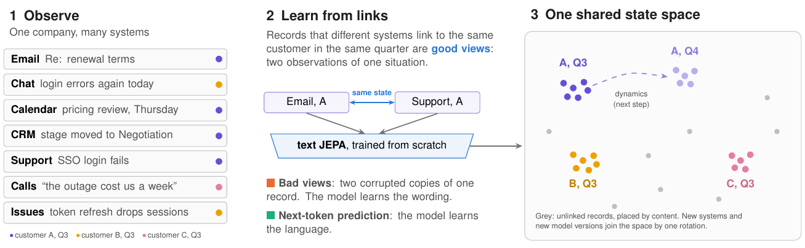

# Toward World Models of Organizations

[](../../actions/workflows/tests.yml)

**Every system sees the same company.** Email, chat, the CRM, support tickets, recorded calls, calendars and issue
trackers each record part of what happens with every customer, deal and project. But none of them records the
situation itself. This repository learns the piece that no system records: a shared **state space** with **access
control built in**. In this space, the situation that each record describes sets its position, whichever system
wrote the record. The state space is the first layer of a **world model of an organization**.



We expect every company to come to run on an *operational world model*: a model of how the company actually
functions. People and AI agents can understand the company through it. They can learn on it, as a new employee
learns the company. They can also use it to try changes before they make them. This repository builds the first
layers of such a model. It also tests, honestly, how far the rest of the model gets on the same data.

The training signal is free. The Platonic Representation Theorem (Balestriero & LeCun, 2026) shows that JEPAs
trained on *good views* converge to the same representation up to a rotation. Good views are two different
observations of the same hidden state. Organizations already keep good views: records that different systems link to the same
customer in the same time window.

We train small text JEPAs on those links, on a simulated company from
[Era by Eon](https://www.eon.io/blog/era-build-and-test-ai-agents). We compare them with corruption-based views
(bad views) and with next-token prediction on identical text. We also repeat the key comparisons with a frozen
pretrained encoder.

**Paper:** [`paper/main.pdf`](paper/main.pdf), version 5. The LaTeX source is in [`paper/`](paper).
**What changed and why:** [`docs/REVIEW_RESPONSE.md`](docs/REVIEW_RESPONSE.md) (every review, point by point),
[`docs/CHECKS.md`](docs/CHECKS.md) (how we checked version 5) and [`CHANGELOG.md`](CHANGELOG.md).

## Website

The interactive project website is in [`website/`](website). GitHub Pages publishes it with
[`.github/workflows/pages.yml`](.github/workflows/pages.yml). Its address will be
[https://niashwin.github.io/company-world-model/](https://niashwin.github.io/company-world-model/).
Turn on GitHub Pages one time: in Settings > Pages, set Source to GitHub Actions. A GitHub Pages site is public on
the internet, also when the repository is private. For a private repository, Pages needs a paid GitHub plan.

To see the website on your computer, run this command. Then open [http://localhost:8000](http://localhost:8000).

```sh
python -m http.server -d website 8000
```

The repository includes the data of the website, so the site works from a clone. To make the data again, run
`python cwm/export_site_data.py` after Path 2 below. It reads `results/`, the filled paper (`paper/main.tex` and
`paper/main.aux`) and the stored embeddings, from which it computes the maps.

## Results at a glance

We use one simulated company. It has seven systems, 21,972 customer-linked records, 21 active customers and exact
ground truth. Every number below is in the paper and in `results/`. Each result uses one seed, unless we give a
different number of seeds.

### The state space (what works)

| Test | Good views | Bad views | Next-token | TF-IDF | Pretrained encoder | Pretrained + good-view head |
| --- | --- | --- | --- | --- | --- | --- |
| **Held-out records** (links hidden in training): placed with the right customer | **76%** | 19% | 20% | 53% | 53% | 62% |
| Training records: 10 nearest neighbours **from other systems** on the same customer | **95%** (3 seeds) | 14% | 13% | 35% | 40% | 72% |
| ...with customer names, contacts, domains and ids masked | **48%** | | | 14% | | |
| ...with **employee** names, handles and chat names masked as well | **47%** | | | 14% | | |
| ...when 25% / 50% of the training links are wrong | **84% / 68%** | | | | | |
| Encoders trained **separately** on messages and on systems of record, one rotation from 64 anchors: same-state recall@1 (chance 4%) | **21%** | 4% | 4% | | | |
| **Retrained** encoder that searches the **old** index through one rotation: same-customer precision@10 | **79%** (3% without rotation) | | | | | |

- The links are weak supervision, so numbers on training records are upper bounds. The held-out test is the fair
  one.
- The same good views lift a frozen pretrained sentence encoder (all-MiniLM-L6-v2) from 53% to 62% on held-out
  records. So the recipe also improves a ready-made backbone. On this company it stays below the small encoder
  trained from scratch, which learns the company's own vocabulary.
- Masking employees as well as customers changes almost nothing (48% → 47%). So the residual signal is not "which
  employee handles this customer".

### Access control, built in

A learned world model can leak across access boundaries through three paths. They are search results, states
aggregated over records that a reader may not open, and the encoder's own training. `cwm/acl.py` gives every record
its readers. The model closes all three paths. So what a reader receives depends only on what they may read
(non-interference, checked byte for byte).

- **A search filter is not enough.** A support engineer who may not read CRM records searches for a codename that we
  planted in them. With an encoder trained on everything, the search returns the right customer **100%** of the
  time. This happens even though we filter the search to readable records. With access control built in, every
  result is identical with and without the planted secrets. This is true for the from-scratch encoder and for the
  pretrained backbone with per-reader heads.
- **The cost, and what we can recover while the guarantee holds** (held-out readable records placed with the right
  customer):

| Reader (share readable) | Own encoder | Backbone + own head | Both side by side | Trained on everything (leaks) |
| --- | --- | --- | --- | --- |
| CEO (100%) | **76%** | 62% | | 76% |
| Account executive (81%) | **76%** | 70% | | 78% |
| Support engineer (86%) | **74%** | 61% | | 75% |
| Software engineer (22%) | 28% | 29% | **32%** | 66% |
| Financial analyst (9%) | 23% | **43%** | 30% | 65% |

  A pretrained backbone holds no company data, so every reader may share it. It helps the financial analyst
  substantially (23% → 43%, against 65% for the encoder that leaks). But it barely helps the software engineer, whose records are 87% support tickets. A base trained on
  the 534 linked records that everyone may read does not help.

  **Rotations cannot help by construction.** They make the views of different readers comparable. But no rotation
  changes nearest-centroid placement (unit-tested). Also, a rotation toward a space that the reader may not read
  would itself depend on records outside their rights.

  A size-matched random sample of all systems places 42% and 31% of the two readers' records. So most of the gap to
  "trained on everything" comes from the records that a reader may not read at all. Knowledge from outside the
  company can close part of the gap, as the backbone does for the analyst. Only a change in the access policy can
  close the rest.

### The rest of a world model: a division of labor

| Question | Result |
| --- | --- |
| **Two channels** (state + detail) on the 144 memory questions, which name their customer, 4 seeds | The stores retrieve by content within the question's quarter. Detail only (pretrained) 71.2%, state only (good views) 65.8%, concatenated 72.2%, routed (retrieve by state, read detail) 70.1%. **No combination clearly beats the detail channel** (concatenated minus detail: +1.0 points, 95% interval −2.4 to +4.7). Both channels find the named customer's records equally often (65%). So the lead of the detail store comes from how the reader reads its records, or from how we embed the question. The detail store does not find more of the right records. |
| **Questions that come with one record of the customer instead of its name** (127 questions; 4 seeds of the reader and anchors; 1 state encoder) | Names kept: **the state channel places the record**, then the reader reads its customer's records and answers **63.8%**. Placement with the pretrained encoder: 54.9% (**paired +8.9 points, 95% interval +3.9 to +13.8**). Nearest neighbours of the record 58–60%, no store 52.2%, the record's own link (oracle) 68.7%, placement with both channels concatenated 64.2%. Names masked: only the oracle helps clearly (67.1%). The state channel's neighbours help a little (57.7% vs 52.0%). Given the right records, the reader answers 67.5–68.1% from only their system and time codes, about as well as from their content. |
| Two channels for state facts ("was there a sales call this quarter?") | Good views alone: 72% (about the majority). With a pretrained detail channel: 87%. With bad views: 95%. The detail channel restores the facts. But no combination beats its better channel on average. |
| **Monthly windows** (405 states on day 1, 398 transitions through day 2) | Held-out records placed in the right customer-month: 17%, vs 13% for "customer known, busiest month". Finer windows help a little. |
| Forecasting next month's facts | 44–54% for every representation, vs 54% for the majority class and 72% if we copy this month's facts. **No forecast.** |
| Linear dynamics (state → next state) | We tune the regularization of a ridge map by nested cross-validation. Then the map beats "no change" in every space (2–31% less error). But it never beats one shrink-toward-the-mean factor by more than 3.4 points. It learns mean reversion, not dynamics. |
| **Drift** (weekly state jump vs escalations and deal-stage changes, 279 event weeks) | AUROC 0.47–0.54, within about two standard errors of chance. Record volume alone: 0.57. |
| **Cross-team misalignment** (sales vs support state distance vs at-risk months) | AUROC 0.48–0.57, within noise. |
| **Decisions: action-conditioned dynamics.** Six company actions per customer-month, which we read from the company's logs and Era's ground truth. They are sales calls, leaders' messages, CRM tasks, engineering escalations, support replies and outbound email. | This month's actions add nothing to predictions of next month's state (error change −0.1% to +0.6% of the state-only error, where positive is worse). In the good-view space, the state already encodes most of them: we predict each action from the state with AUROC 0.63–0.88. Next month's actions lower the error by 9–19%, mostly as a description of next month's records. With next month's mix of systems in the model, they add 3–5%. Next-month outcomes: actions add +0.02 to +0.26 AUROC, and support replies alone do as well as all six. Replies mark months with tickets, and tickets persist. |
| **Decisions: around single actions** (14-day windows, records of the action's kind left out) | After an adjustment for the record count of each window, no action moves the state detectably more than matched times. Engineering escalations +0.009 (95% interval −0.003 to +0.017, +0.011 before the adjustment), sales calls 0.000, leaders' messages −0.024. Knowledge of the action does not help to predict where the state goes. |
| **Decisions: a simulation of intervention vs no intervention for customers in trouble** (29 customer-months) | The machinery works: it finds similar states of other customers and splits them by what the company did. But the logs barely contain the alternative: the company intervened in 25 of 29. In all four state spaces, similar states where it intervened were in trouble 19–24% of the time, vs 0.2–4% where it did not. So more urgent tickets appear to follow interventions, as we would see if calls and escalations come when problems are severe. The estimates move with the state space: +12 to +15 points for deals and +8 to +29 for urgent tickets. Six of the eight intervals include zero. The outcome model attributes little to the decision. **Learning from decisions needs actions with a known assignment.** |
| **Similar situations across customers** | Of the 5 nearest states of other customers, 18% share the situation, vs 8% by chance. Every representation does about as well. When we restrict the neighbours to other quarters, it is still 17% vs 7%. For customers in trouble, the detail channel finds others in trouble (bad views 35%, pretrained 25%, vs a 12% base rate). The state channel does not (4%). |

The experiments point to a division of labor. We can learn the **state space** from links alone. It places records
without links. Through rotations, different encoders can share it. It can also carry access control.

A **memory** should find a question's records through the state space, or by name when the question has one. It
should then read them from the store. For questions about how many tickets there were or whether a call took place,
the provenance of the right records carries most of the answer.

A **predictor** of how states change did not emerge from a space trained for static similarity. When we condition it
on the company's logged actions, this does not change. The company intervened in situations unlike those where it
did not intervene. So its logs show the situations in which it acted, rather than the effect of its actions. A
**decision layer** needs actions with a known assignment (logged with reasons, deliberately varied, or replayed in a
simulator).

Every encoder and head that we timed trains in **2–7 minutes on a CPU**, without a GPU. So at this scale, a company
could retrain its state space and each access scope's model daily, or whenever an access rule changes. We did not
test how training time grows with millions of records.

## Reproduce

Everything runs on a CPU. There are two paths. [`REPRODUCE.md`](REPRODUCE.md) gives the details. It also has a
table that maps each part of the paper to its command and result file.

**Path 1** rebuilds the figures and the paper from the stored results in `results/`, in a minute:

```sh
pip install -r requirements.txt
make all            # figures, then the results from results/ into the paper, then the PDF
pytest -q tests     # checks that need no Era data
```

If your system has `python3` but no `python`, run `make all PY=python3`.

**Path 2** runs every experiment again, from the simulated company to the PDF and the website. It takes several
hours on two cores. It needs Docker. You need no Docker Hub account to get Era's simulator images.

```sh
bash scripts/reproduce.sh
```

`cwm/fill_paper.py` writes the results into the paper from `results/`, and `tests/test_paper_numbers.py` checks the
numbers that the text states directly. `pytest -q tests` needs no Era data. It checks a tiny synthetic company, the
access policy, non-interference, the good-view head and the rotation invariance of placement.

The seed (42) and the simulated date (2026-10-31) in `cwm/era_up.sh` fix the exact company. Runs are deterministic
for a given seed and thread count, but not across thread counts. The version-2 runs used
`THREADS=1 OMP_NUM_THREADS=1` on two cores. `scripts/reproduce.sh` uses these settings by default.

## Writing standard

In version 5, the paper, this README and the website follow the rules of ASD-STE100 (Simplified Technical English).
Our target is that at least 90% of the sentences comply. `tools/ste_check.py` measures this. It checks each sentence
for the main rules: length, active voice, simple tenses and no -ing forms. The score is the share of sentences that
comply. It is 98% for the paper and more than 99% for this README and the website.

The tool cannot check the approved dictionary of STE, so we use the technical terms of the field where we must. To
measure the paper, run:

```sh
python tools/ste_check.py paper/main.tex
```

`make check` runs the tests and fails if the share is less than 90%. `tools/tex_invariants.py` checks that an
edit of the paper keeps every placeholder, label, reference and citation.

## Layout

| Path | What it is |
| --- | --- |
| `cwm/era_up.sh`, `cwm/era_export.py` | Start Era's seven simulators and export every record into one table plus ground truth |
| `cwm/corpus_stats.py` | Counts the records: Table 1 and the counts of Section 5 (`results/corpus.json`) |
| `cwm/data.py` | Records to states (customer × quarter, month or ISO week), tokens, system families |
| `cwm/jepa.py` | Bag-of-n-grams encoder, LeJEPA loss with SIGReg, good and bad views, next-token baseline |
| `cwm/pretrained.py` | Frozen all-MiniLM-L6-v2 backbone and the good-view JEPA head trained on its features |
| `cwm/metrics.py` | Cross-system neighbour precision, probes, explained fractions, Procrustes, mutual kNN |
| `cwm/run_prh.py`, `cwm/run_e3b.py` | Main comparison, alignment across systems, behaviour over time |
| `cwm/run_extras.py` | Extra seeds, identity masking (customers, or customers and employees), wrong links, held-out records |
| `cwm/run_state.py` | State tracking and forecasting probes |
| `cwm/acl.py`, `cwm/run_acl.py` | Access policy, per-reader encoders, leak tests, cost and non-interference |
| `cwm/memory.py`, `cwm/run_memory2.py` | Memory-token reader over the store: state-only, detail-only, concatenated and routed stores |
| `cwm/run_memory_anchor.py` | Questions that come with a record of the customer instead of its name: nearest-neighbour, placement and link-oracle stores, names masked or kept |
| `cwm/memory_retrieval.py` | Which records the named-question stores retrieve |
| `cwm/run_actions.py` | Decisions: the company's actions per customer and month, action-conditioned dynamics, event windows, decision simulation |
| `cwm/make_minilm.py` | Caches the frozen backbone's features for every linked record |
| `cwm/run_v2.py` | Version-2 experiments: pretrained baselines, monthly windows, access control with a shared backbone, two channels, dynamics, drift, misalignment, similar situations, scope diagnostic |
| `cwm/make_figures.py`, `cwm/fill_paper.py` | `make_figures.py` draws the figures. `cwm/fill_paper.py` writes the results into the paper from `results/`, and `tests/test_paper_numbers.py` checks the numbers that the text states directly. |
| `cwm/export_site_data.py` | Rebuilds the data of the website (`website/data/site-data.js`) from `results/` and the filled paper, and writes `website/index.html` from `website/template.html` |
| `scripts/reproduce.sh` | Runs every experiment again, from the simulated company to the PDF and the website, in stages (`data`, `v1` to `v4`, `paper`, `site`) |
| [`REPRODUCE.md`](REPRODUCE.md) | How to reproduce the paper, by two paths. A table maps each part of the paper to its command and result file. |
| `tests/` | Smoke tests that GitHub Actions runs on every push |
| `tools/ste_check.py`, `tools/tex_invariants.py` | `ste_check.py` measures how closely a text follows ASD-STE100. `tex_invariants.py` checks that an edit of the paper keeps every placeholder, label, reference and citation. |
| `tools/make_og_image.py` | Renders `website/assets/og.png`, the image that link previews of the website show |
| `results/` | Every result that the paper reports, as JSON. New in version 2: `v2_*.json`, `extras_e.json` and `memory2_{minilm4,dual,route}.json`. New in version 3: `memory_anchor_*.json` and `memory2_q_*.json`. New in version 4: `actions.json`. Files that end in `_a`, `_b`, ... are parallel runs, and `fill_paper.py` merges them. |
| `paper/` | LaTeX source (`main.in.tex` with placeholders, generated `main.tex`), figures, bibliography, PDF |
| `website/` | The project website. `template.html` is the source of the page, and `cwm/export_site_data.py` generates `index.html` from it. |
| `.github/workflows/pages.yml` | Publishes `website/` and the PDF of the paper with GitHub Pages |
| `docs/REVIEW_RESPONSE.md` | Point-by-point answers to every review, from version 1 to version 4 |
| `docs/CHECKS.md` | The checks of version 5 and their results: tests of the numbers, a clean rebuild, the STE measure and the independent reviews |
| `docs/ARXIV_ABSTRACT.txt` | A shorter abstract that fits arXiv's 1,920-character limit |

## Moving to real data

Replace `era_export.py` with connectors for your own systems. Keep the record schema:
`system, ts, author, thread, text`, plus link fields such as `account_id`. Link fields only decide which records
are positives. The encoders never read them.

Replace the role-based policy in `cwm/acl.py` with each system's own permissions (channel membership, email
recipients, per-record access). The three controls stay the same. All access scopes may share a frozen pretrained
backbone, because it holds no company data. Heads, states and indexes are per scope.

## Data and licence

Era by Eon is free and generates a synthetic company. No real person, customer or conversation is part of it. We do
not redistribute the generated data here. Regenerate it with `cwm/era_up.sh` and `cwm/era_export.py`, or with
`bash scripts/reproduce.sh data`. Check Era's terms before you share it. The MIT licence applies to the code (see
`LICENSE`).

## Citation

```bibtex
@techreport{gopinath2026organizations,
  title       = {Toward World Models of Organizations: Every System Sees the Same Company},
  author      = {Gopinath, Ashwin},
  institution = {Sentra},
  address     = {San Francisco},
  year        = {2026},
  month       = nov,
  note        = {Version 5},
  url         = {https://github.com/niashwin/company-world-model}
}
```

## Acknowledgments

Era by Eon is free and made this work possible. SIGReg follows LeJEPA (Balestriero & LeCun, 2025). The
implementation here is our own. The memory reader follows Memorilla (Fallahpour et al., 2026). The pretrained
backbone is all-MiniLM-L6-v2 from Sentence-Transformers.
