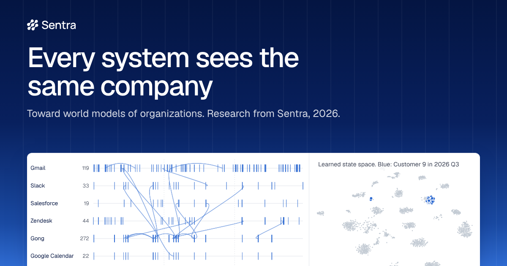

<p>
  <a href="https://www.sentra.app"><picture>
    <source media="(prefers-color-scheme: dark)" srcset="website/assets/brand/sentra-lockup-white.svg">
    
  </picture></a>
</p>

# Every system sees the same company

**Toward world models of organizations.** Ashwin Gopinath, Sentra, San Francisco. Technical report, version 7,
November 2026.

[Website](https://niashwin.github.io/company-world-model/) |
[Paper (PDF)](paper/main.pdf) |
[Cite](#citation) |
[](../../actions/workflows/tests.yml)

[](https://niashwin.github.io/company-world-model/)

## In one minute

A company is a world of its own. Every customer, deal and project has a state: how things stand right now. Email,
chat, the CRM, support tickets and calls each see a part of that state, and no system sees the whole of it. Most AI
assistants rebuild the picture from documents for each question, and then forget it.

This work shows that AI can learn the state itself, from the links that a company's systems already keep. The method
comes from world models, which let AI learn the state of the physical world from video. Yann LeCun's
[JEPA](https://openreview.net/forum?id=BZ5a1r-kVsf) learns to predict one view of a scene from another view of it.
Randall Balestriero and Yann LeCun [proved](https://arxiv.org/abs/2610.39302) that such models, with the right pairs
of views, converge to one picture of the true state. A company's links supply those pairs. An email, a ticket and a
CRM update about one customer in one week are three views of one situation.

We test the idea on a simulated company from [Era by Eon](https://arxiv.org/abs/2609.09853), with exact ground
truth: 78,048 records in seven systems, and 21 customers. With a simulation, we can check every answer against the
truth.

## What we found, and why it matters

Eight results from the simulated company. Each row says what we tested and what it could mean for a real company.

| Result | What we tested | Why it matters |
| --- | --- | --- |
| **76%** of records find their customer, even without their link | We hid the customer links of 5,366 records. The model put 76% with the right customer. A keyword search put 53%, and a guess of the largest customer 12%. | AI can assemble one picture of each customer from every tool, also from records that lost their link. |
| **33%** without any names | We removed every name, email address and identifier. The model still put 33% of the hidden records with the right customer. A small ready-made AI text model ([MiniLM](https://proceedings.neurips.cc/paper_files/paper/2020/hash/3f5ee243547dee91fbd053c1c4a845aa-Abstract.html)) put 20%, and a guess of the largest customer 12%. | Names do much of the work, but not all of it. The model also learns what each customer's situation looks like. |
| **53% → 62%** for a ready-made AI text model | We added the same training on top of MiniLM. Its share of hidden records with the right customer rose from 53% to 62%. | A company can add this training to a model that it already runs, and does not have to replace the model. We tested one small model. |
| **No leak** | We planted secret codenames in 150 records that two employees may not read, and searched for them as each employee. A model trained on everything pointed to the right customer every time, even when we filtered the results to what the employee may read. Models trained only on what each employee may read gave the same results with and without the secrets. | A permission filter on search results is not enough. When each group's model learns only from what the group may read, it cannot reveal the rest. People who may read little get less accurate results. |
| **63.8%** from one email | Questions came with one email or ticket instead of the customer's name. The answers were right 63.8% of the time, against 54.9% with MiniLM and 52.2% with no memory. A system that knows the email's true link gets 68.7%. The names stayed in the records for this test. | One email can stand in for the customer's name: a forwarded email or a ticket can bring the right customer's records. |
| **13–21%** similar situations | For each customer and quarter, we found the five most similar quarters of other customers. Of these, 13–21% shared the situation, against 8% by chance. The share depends on the representation. | "Have we seen this before?" gets a first, rough answer. |
| **25 of 29** months with an intervention | In 25 of 29 months in which a customer was in trouble, the company stepped in. | Logs show what a company did, not what worked. To learn what works, a company must record its decisions and their reasons, and sometimes vary them on purpose. |
| **2–7 minutes** to train | We timed each model on an ordinary computer, without a GPU. | With 21,972 linked records, as here, a company can train the model again often. It can keep a separate model for each group of people with the same access. We did not test a company with millions of records. |

## Why it matters: from a memory to a model of the company

We call the goal corporate AI: AI that understands how a company works, acts within each person's permissions and
helps the company decide. We see four layers on the way there. Each layer is useful on its own, and each one makes the
next one possible.

| Layer | What it gives | Status |
| --- | --- | --- |
| Memory that accumulates | What happened, who decided it and why, and where each fact came from | In place: products such as [Sentra](https://www.sentra.app) build this layer today |
| **Representations that learn** | **One learned state space for the company, which places most records with their customer** | **This work, shown in simulation** |
| Models that predict | How situations change, and what decisions do | Next: this work builds a first version and shows what data it needs |
| Organizations that improve | People and AI agents test decisions against the model, and the model learns from what happens | Future |

The learned state space does not replace the memory. The memory keeps the facts, sources and permissions. The state
space adds two things: a place for records without a link, and a measure of which situations are alike.

## How it compares

Other approaches give AI knowledge of a company in different ways, and they work best together. Table 1 of the paper
gives this comparison with references.

| Approach | What it keeps | Where it is strong | What it leaves open |
| --- | --- | --- | --- |
| Retrieval ([RAG](https://proceedings.neurips.cc/paper/2020/hash/6b493230205f780e1bc26945df7481e5-Abstract.html)) | Documents and a search index | Current and simple, with permission filters on results | Builds each situation again for each question |
| Company memory and knowledge graphs ([GraphRAG](https://arxiv.org/abs/2404.16130), [Zep](https://arxiv.org/abs/2501.13956), [MemGPT](https://arxiv.org/abs/2310.08560), [Mem0](https://doi.org/10.3233/FAIA251160)) | Entities, facts, decisions, dates and sources | Facts with sources, easy to audit and update | Facts, not a learned state of each situation |
| Compressed memory ([Memorilla](https://arxiv.org/abs/2610.21375)) | Embeddings of documents, read as 16 memory tokens for each question by a frozen model | A large collection in a few tokens (84.33% on FactKG, against 80.43% with the full context) | Organizes documents, not situations |
| Trained context and skills ([Cartridges](https://proceedings.iclr.cc/paper_files/paper/2026/hash/4681359a7b1e94571598ad1adda35e6e-Abstract-Conference.html), [Engram](https://engram.com/blog/learning-in-a-world-of-notes)) | A trained cache of the documents, or notes and a model trained to use them | Better and cheaper answers (Engram reports 7 to 20 points from training to use notes) | Organizes text, not situations |
| [Process mining](https://doi.org/10.1007/978-3-662-49851-4) | Event logs that a case number links | Shows how work flows | Needs structured events, not text |
| World models of physical scenes ([V-JEPA 2](https://arxiv.org/abs/2506.09985), [H-JEPA](https://arxiv.org/abs/2610.06805)) | Latent states of a scene | Prediction and planning | Built for cameras and sensors, not for records and permissions |
| **This work** | **A learned state of each situation, from the links between systems** | **Places records whose links it never saw; permissions built in** | **Prediction of change, and the effects of decisions; tested on one simulated company** |

Our memory reader follows Memorilla in a small form, so a reader of this kind could read situations instead of
separate documents. Agents trained to use notes could act on a shared state that respects permissions. We tested
only the first of these combinations.

## Website

The interactive project website is part of this repository, in [`website/`](website). It explains the work for a
general reader, shows every result with an interactive figure, and lists every reference with a link. GitHub Pages
publishes it with [`.github/workflows/pages.yml`](.github/workflows/pages.yml), together with the PDF of the paper.
Its address will be [https://niashwin.github.io/company-world-model/](https://niashwin.github.io/company-world-model/).
Turn on GitHub Pages one time: in Settings > Pages, set Source to GitHub Actions. A GitHub Pages site is public on
the internet, also when the repository is private. For a private repository, Pages needs a paid GitHub plan.

To see the website on your computer, run this command. Then open [http://localhost:8000](http://localhost:8000).

```sh
python -m http.server -d website 8000
```

The repository includes the data of the website, so the site works from a clone. To make the data again, run
`python cwm/export_site_data.py` after Path 2 below. It reads `results/`, the filled paper (`paper/main.tex` and
`paper/main.aux`) and the stored embeddings, from which it computes the maps.

## For researchers: results at a glance

We use one simulated company. It has seven systems, 21,972 customer-linked records, 21 active customers and exact
ground truth. Every number below is in the paper and in `results/`. Each result uses one seed, unless we give a
different number of seeds.

### The state space (what works)

| Test | Good views | Bad views | Next-token | TF-IDF | Pretrained encoder | Pretrained + good-view head |
| --- | --- | --- | --- | --- | --- | --- |
| **Held-out records** (links hidden in training): placed with the right customer | **76%** | 19% | 20% | 53% | 53% | 62% |
| Training records: 10 nearest neighbours **from other systems** on the same customer | **95%** (3 seeds) | 14% | 13% | 35% | 40% | 72% |
| Held-out records with **every name and identifier masked**: placed with the right customer | **33%** | | | | 20% | |
| ...with customer names, contacts, domains and ids masked (training records) | **48%** | | | 14% | | |
| ...with **employee** names, handles and chat names masked as well | **47%** | | | 14% | | |
| ...when 25% / 50% of the training links are wrong | **84% / 68%** | | | | | |
| Encoders trained **separately** on messages and on systems of record, one rotation from 64 anchors: same-state recall@1 (chance 4%) | **21%** | 4% | 4% | | | |
| **Retrained** encoder that searches the **old** index through one rotation: same-customer precision@10 | **79%** (3% without rotation) | | | | | |

- The held-out test is the main one: the encoder never saw the links of these records. A guess of the largest
  customer places 12% of them.
- The same good views lift a frozen pretrained sentence encoder (all-MiniLM-L6-v2) from 53% to 62% on held-out
  records. So the recipe also improves a ready-made backbone. On this company it stays below the small encoder
  trained from scratch, which learns the company's own vocabulary.
- Masking employees as well as customers changes almost nothing (48% → 47%). So the residual signal is not "which
  employee handles this customer".

### Access control, built in

A learned world model can leak across access boundaries through three paths. They are search results, states
aggregated over records that a reader may not open, and the encoder's own training. `cwm/acl.py` gives every record
its readers. The model closes all three paths. So what a reader receives depends only on what they may read
(non-interference, checked byte for byte).

- **A search filter is not enough.** A support engineer who may not read CRM records searches for a codename that we
  planted in them. With an encoder trained on everything, the search returns the right customer **100%** of the
  time. This happens even though we filter the search to readable records. With access control built in, every
  result is identical with and without the planted secrets. This is true for the from-scratch encoder and for the
  pretrained backbone with per-reader heads.
- **The cost, and what we can recover while the guarantee holds** (held-out readable records placed with the right
  customer):

| Reader (share readable) | Own encoder | Backbone + own head | Both side by side | Trained on everything (leaks) |
| --- | --- | --- | --- | --- |
| CEO (100%) | **76%** | 62% | | 76% |
| Account executive (81%) | **76%** | 70% | | 78% |
| Support engineer (86%) | **74%** | 61% | | 75% |
| Software engineer (22%) | 28% | 29% | **32%** | 66% |
| Financial analyst (9%) | 23% | **43%** | 30% | 65% |

  A pretrained backbone holds no company data, so every reader may share it. It helps the financial analyst
  substantially (23% → 43%, against 65% for the encoder that leaks). But it barely helps the software engineer, whose records are 87% support tickets. A base trained on
  the 534 linked records that everyone may read does not help.

  **Rotations cannot help by construction.** They make the views of different readers comparable. But no rotation
  changes nearest-centroid placement (unit-tested). Also, a rotation toward a space that the reader may not read
  would itself depend on records outside their rights.

  A size-matched random sample of all systems places 42% and 31% of the two readers' records. So most of the gap to
  "trained on everything" comes from the records that a reader may not read at all. Knowledge from outside the
  company can close part of the gap, as the backbone does for the analyst. Only a change in the access policy can
  close the rest.

### Toward prediction and decisions

| Question | Result |
| --- | --- |
| **Two channels** (state + detail) on the 144 memory questions, which name their customer, 4 seeds | The stores retrieve by content within the question's quarter. Detail only (pretrained) 71.2%, state only (good views) 65.8%, concatenated 72.2%, routed (retrieve by state, read detail) 70.1%. **No combination clearly beats the detail channel** (concatenated minus detail: +1.0 points, 95% interval −2.4 to +4.7). Both channels find the named customer's records equally often (65%). So the lead of the detail store comes from how the reader reads its records, or from how we embed the question. The detail store does not find more of the right records. |
| **Questions that come with one record of the customer instead of its name** (127 questions; 4 seeds of the reader and anchors; 1 state encoder) | Names kept: **the state channel places the record**, then the reader reads its customer's records and answers **63.8%**. Placement with the pretrained encoder: 54.9% (**paired +8.9 points, 95% interval +3.9 to +13.8**). Nearest neighbours of the record 58–60%, no store 52.2%, the record's own link (oracle) 68.7%, placement with both channels concatenated 64.2%. Names masked: the state channel's neighbours, read by detail, answer 57.7% against 52.0% without a store (paired +5.7 points, 95% interval +0.4 to +10.8). The oracle answers 67.1%. Given the right records, the reader answers 67.5–68.1% from only their system and time codes, about as well as from their content. |
| Two channels for state facts ("was there a sales call this quarter?") | Good views alone: 72% (about the majority). With a pretrained detail channel: 87%. With bad views: 95%. The detail channel restores the facts. But no combination beats its better channel on average. |
| **Monthly windows** (405 states on day 1, 398 transitions through day 2) | Held-out records placed in the right customer-month: 17%, vs 13% for "customer known, busiest month". Finer windows help a little. |
| Forecasting next month's facts | 44–54% for every representation, vs 54% for the majority class and 72% if we copy this month's facts. A forecast needs training for change. |
| Linear dynamics (state → next state) | We tune the regularization of a ridge map by nested cross-validation. Then the map beats "no change" in every space (2–31% less error). But it never beats one shrink-toward-the-mean factor by more than 3.4 points. Most of what it learns is a return toward the mean. |
| Drift and cross-team misalignment (weekly state jumps; distance between sales and support states) | As signals of escalations, deal-stage changes or at-risk months, AUROC 0.47–0.57. Record volume alone gives 0.57. |
| **Decisions: action-conditioned dynamics.** Six company actions per customer-month, which we read from the company's logs and Era's ground truth. They are sales calls, leaders' messages, CRM tasks, engineering escalations, support replies and outbound email. | This month's actions add nothing to predictions of next month's state (error change −0.1% to +0.6% of the state-only error, where positive is worse). In the good-view space, the state already encodes most of them: we predict each action from the state with AUROC 0.63–0.88. Next month's actions lower the error by 9–19%, mostly as a description of next month's records. With next month's mix of systems in the model, they add 3–5%. Next-month outcomes: actions add +0.02 to +0.26 AUROC, and support replies alone do as well as all six. Replies mark months with tickets, and tickets persist. |
| **Decisions: around single actions** (14-day windows, records of the action's kind left out) | After an adjustment for the record count of each window, no action moves the state detectably more than matched times. Engineering escalations +0.009 (95% interval −0.003 to +0.017, +0.011 before the adjustment), sales calls 0.000, leaders' messages −0.024. Knowledge of the action does not help to predict where the state goes. |
| **Decisions: a simulation of intervention vs no intervention for customers in trouble** (29 customer-months) | The machinery works: it finds similar states of other customers and splits them by what the company did. But the logs barely contain the alternative: the company intervened in 25 of 29. In all four state spaces, similar states where it intervened were in trouble 19–24% of the time, vs 0.2–4% where it did not. So more urgent tickets appear to follow interventions, as we would see if calls and escalations come when problems are severe. The estimates move with the state space: +12 to +15 points for deals and +8 to +29 for urgent tickets. Six of the eight intervals include zero. The outcome model attributes little to the decision. **Learning from decisions needs actions with a known assignment.** |
| **Similar situations across customers** | Of the 5 nearest states of other customers, 18% share the situation, vs 8% by chance. Every representation does about as well. When we restrict the neighbours to other quarters, it is still 17% vs 7%. Good views make the state sensitive to whose situation it is. So for "customers in trouble", representations that keep detail are the right tool. Bad views find 35%, pretrained 25% and good views 4%, against a 12% base rate. The two channels concatenated find 5%, so each channel should answer its own kind of query. |

The experiments point to a division of labor. We can learn the **state space** from links alone. It places records
whose links it never saw. Through rotations, different encoders can share it. It can also carry access control.

A **memory** should find a question's records through the state space, or by name when the question has one. It
should then read them from the store. For questions about how many tickets there were or whether a call took place,
the provenance of the right records carries most of the answer.

A **predictor** of how states change needs training for change. A space trained for similarity gives little of it on
its own, also with the company's logged actions. The company intervened in situations unlike those where it did not
intervene. So its logs show the situations in which it acted, rather than the effect of its actions. A
**decision layer** needs actions with a known assignment (logged with reasons, deliberately varied, or replayed in a
simulator).

Every encoder and head that we timed trains in **2–7 minutes on a CPU**, without a GPU. So at this scale, a company
could retrain its state space and each access scope's model daily, or whenever an access rule changes. We did not
test how training time grows with millions of records.

## Reproduce

Everything runs on a CPU. There are two paths. [`REPRODUCE.md`](REPRODUCE.md) gives the details. It also has a
table that maps each part of the paper to its command and result file.

**Path 1** rebuilds the figures and the paper from the stored results in `results/`, in a minute:

```sh
pip install -r requirements.txt
make all            # figures, then the results from results/ into the paper, then the PDF
pytest -q tests     # checks that need no Era data
```

If your system has `python3` but no `python`, run `make all PY=python3`.

**Path 2** runs every experiment again, from the simulated company to the PDF and the website. It takes several
hours on two cores. It needs Docker. You need no Docker Hub account to get Era's simulator images.

```sh
bash scripts/reproduce.sh
```

`cwm/fill_paper.py` writes the results into the paper from `results/`, and `tests/test_paper_numbers.py` checks the
numbers that the text states directly. `pytest -q tests` needs no Era data. It checks a tiny synthetic company, the
access policy, non-interference, the good-view head and the rotation invariance of placement.

The seed (42) and the simulated date (2026-10-31) in `cwm/era_up.sh` fix the exact company. Runs are deterministic
for a given seed and thread count, but not across thread counts. The version-2 runs used
`THREADS=1 OMP_NUM_THREADS=1` on two cores. `scripts/reproduce.sh` uses these settings by default.

## Writing standard

Since version 5, the paper, this README and the website follow the rules of ASD-STE100 (Simplified Technical English).
Our target is that at least 90% of the sentences comply. `tools/ste_check.py` measures this. It checks each sentence
for the main rules: length, active voice, simple tenses and no -ing forms. The score is the share of sentences that
comply. It is 98% for the paper and more than 99% for this README and the website.

The tool cannot check the approved dictionary of STE, so we use the technical terms of the field where we must. To
measure the paper, run:

```sh
python tools/ste_check.py paper/main.tex
```

`make check` runs the tests and fails if the share is less than 90%. `tools/tex_invariants.py` checks that an
edit of the paper keeps every placeholder, label, reference and citation.

## Layout

| Path | What it is |
| --- | --- |
| `cwm/era_up.sh`, `cwm/era_export.py` | Start Era's seven simulators and export every record into one table plus ground truth |
| `cwm/corpus_stats.py` | Counts the records: Extended Data Table 1 and the counts in Methods (`results/corpus.json`) |
| `cwm/data.py` | Records to states (customer × quarter, month or ISO week), tokens, system families |
| `cwm/jepa.py` | Bag-of-n-grams encoder, LeJEPA loss with SIGReg, good and bad views, next-token baseline |
| `cwm/pretrained.py` | Frozen all-MiniLM-L6-v2 backbone and the good-view JEPA head trained on its features |
| `cwm/metrics.py` | Cross-system neighbour precision, probes, explained fractions, Procrustes, mutual kNN |
| `cwm/run_prh.py`, `cwm/run_e3b.py` | Main comparison, alignment across systems, behaviour over time |
| `cwm/run_extras.py` | Extra seeds, identity masking (customers, or customers and employees), wrong links, held-out records |
| `cwm/run_state.py` | State tracking and forecasting probes |
| `cwm/acl.py`, `cwm/run_acl.py` | Access policy, per-reader encoders, leak tests, cost and non-interference |
| `cwm/memory.py`, `cwm/run_memory2.py` | Memory-token reader over the store: state-only, detail-only, concatenated and routed stores |
| `cwm/run_memory_anchor.py` | Questions that come with a record of the customer instead of its name: nearest-neighbour, placement and link-oracle stores, names masked or kept |
| `cwm/memory_retrieval.py` | Which records the named-question stores retrieve |
| `cwm/run_actions.py` | Decisions: the company's actions per customer and month, action-conditioned dynamics, event windows, decision simulation |
| `cwm/make_minilm.py` | Caches the frozen backbone's features for every linked record |
| `cwm/run_v2.py` | Version-2 experiments: pretrained baselines, monthly windows, access control with a shared backbone, two channels, dynamics, drift, misalignment, similar situations, scope diagnostic |
| `cwm/make_figures.py`, `cwm/fill_paper.py` | `make_figures.py` draws the figures. `cwm/fill_paper.py` writes the results into the paper from `results/`, and `tests/test_paper_numbers.py` checks the numbers that the text states directly. |
| `cwm/export_site_data.py` | Rebuilds the data of the website (`website/data/site-data.js`) from `results/` and the filled paper, and writes `website/index.html` from `website/template.html` |
| `cwm/bibrefs.py` | Reads `paper/refs.bib` and writes the linked reference list of the website |
| `scripts/reproduce.sh` | Runs every experiment again, from the simulated company to the PDF and the website, in stages (`data`, `v1` to `v4`, `paper`, `site`) |
| [`REPRODUCE.md`](REPRODUCE.md) | How to reproduce the paper, by two paths. A table maps each part of the paper to its command and result file. |
| `tests/` | Smoke tests that GitHub Actions runs on every push |
| `tools/ste_check.py`, `tools/tex_invariants.py` | `ste_check.py` measures how closely a text follows ASD-STE100. `tex_invariants.py` checks that an edit of the paper keeps every placeholder, label, reference and citation. |
| `tools/make_og_image.py` | Renders `website/assets/og.png`, the image that link previews of the website show |
| `tools/readme_refs.py` | Writes the list of all references, with links, into this README from `paper/refs.bib` |
| `results/` | Every result that the paper reports, as JSON. New in version 2: `v2_*.json`, `extras_e.json` and `memory2_{minilm4,dual,route}.json`. New in version 3: `memory_anchor_*.json` and `memory2_q_*.json`. New in version 4: `actions.json`. Files that end in `_a`, `_b`, ... are parallel runs, and `fill_paper.py` merges them. |
| `paper/` | LaTeX source (`main.in.tex` with placeholders, generated `main.tex`), figures, bibliography, PDF |
| `website/` | The project website. `template.html` is the source of the page, and `cwm/export_site_data.py` generates `index.html` from it. `assets/brand/` holds the Sentra logo, and `assets/fonts/` the Geist fonts (SIL Open Font License). |
| `.github/workflows/pages.yml` | Publishes `website/` and the PDF of the paper with GitHub Pages |
| `docs/REVIEW_RESPONSE.md` | Point-by-point answers to every review, from version 1 to version 6 |
| `docs/CHECKS.md` | The checks of version 7 and their results: tests of the numbers, a clean rebuild, the references, the STE measure and the independent reviews |
| `docs/ARXIV_ABSTRACT.txt` | A shorter abstract that fits arXiv's 1,920-character limit |

## Moving to real data

Replace `era_export.py` with connectors for your own systems. Keep the record schema:
`system, ts, author, thread, text`, plus link fields such as `account_id`. Link fields only decide which records
are positives. The encoders never read them.

Replace the role-based policy in `cwm/acl.py` with each system's own permissions (channel membership, email
recipients, per-record access). The three controls stay the same. All access scopes may share a frozen pretrained
backbone, because it holds no company data. Heads, states and indexes are per scope.

## Data and licence

Era by Eon is free and generates a synthetic company. No real person, customer or conversation is part of it. We do
not redistribute the generated data here. Regenerate it with `cwm/era_up.sh` and `cwm/era_export.py`, or with
`bash scripts/reproduce.sh data`. Check Era's terms before you share it. The MIT licence applies to the code (see
`LICENSE`).

## References

The key references, with links. The full list of 56 follows them. The
[website](https://niashwin.github.io/company-world-model/#cite) lists all 56 too, each with a link to its source.

<!-- ste:off -->

- R. Balestriero and Y. LeCun. [Proving and Improving the Platonic Representation Hypothesis with JEPAs](https://arxiv.org/abs/2610.39302). arXiv:2610.39302, 2026.
- Y. LeCun. [A Path Towards Autonomous Machine Intelligence](https://openreview.net/forum?id=BZ5a1r-kVsf). OpenReview preprint, 2022.
- M. Assran, Q. Duval, I. Misra and others. [Self-Supervised Learning from Images with a Joint-Embedding Predictive Architecture](https://doi.org/10.1109/CVPR52729.2023.01499). IEEE/CVF Conference on Computer Vision and Pattern Recognition (CVPR), 2023.
- M. Assran, A. Bardes, D. Fan, Q. Garrido, R. Howes and others. [V-JEPA 2: Self-Supervised Video Models Enable Understanding, Prediction and Planning](https://arxiv.org/abs/2506.09985). arXiv:2506.09985, 2025.
- W. Zhang, B. Terver, M. Rabbat, Y. LeCun and R. Balestriero. [H-JEPA: End-to-End Learning of Hierarchical World Models for Visual Planning](https://arxiv.org/abs/2610.06805). arXiv:2610.06805, 2026.
- R. Balestriero and Y. LeCun. [LeJEPA: Provable and Scalable Self-Supervised Learning Without the Heuristics](https://arxiv.org/abs/2511.08544). arXiv:2511.08544, 2025.
- M. Huh, B. Cheung, T. Wang and P. Isola. [Position: The Platonic Representation Hypothesis](https://proceedings.mlr.press/v235/huh24a.html). International Conference on Machine Learning (ICML), 2024.
- D. Ha and J. Schmidhuber. [World Models](https://arxiv.org/abs/1803.10122). arXiv:1803.10122, 2018.
- B. Gruenbaum, D. Porat, A. Natanzon, R. Zavida, C. Dinachi and O. Itzahary. [The Era by Eon Benchmark: A Generated Enterprise Estate with Exact Ground Truth for Benchmarking LLM Agents](https://arxiv.org/abs/2609.09853). arXiv:2609.09853, 2026.
- A. Fallahpour, P. Idehpour, V. Kothapalli and others. [Memorilla: Latent Semantic Memory for LLMs](https://arxiv.org/abs/2610.21375). arXiv:2610.21375, 2026.
- Engram. [Learning in a World of Notes](https://engram.com/blog/learning-in-a-world-of-notes). Research note, 2026.
- S. Eyuboglu, R. Ehrlich, S. Arora and others. [Cartridges: Lightweight and General-Purpose Long Context Representations via Self-Study](https://proceedings.iclr.cc/paper_files/paper/2026/hash/4681359a7b1e94571598ad1adda35e6e-Abstract-Conference.html). International Conference on Learning Representations (ICLR), 2026.
- P. Lewis, E. Perez, A. Piktus and others. [Retrieval-Augmented Generation for Knowledge-Intensive NLP Tasks](https://proceedings.neurips.cc/paper/2020/hash/6b493230205f780e1bc26945df7481e5-Abstract.html). Advances in Neural Information Processing Systems, 2020.
- D. Edge, H. Trinh, N. Cheng and others. [From Local to Global: A Graph RAG Approach to Query-Focused Summarization](https://arxiv.org/abs/2404.16130). arXiv:2404.16130, 2024.
- P. Rasmussen, P. Paliychuk, T. Beauvais, J. Ryan and D. Chalef. [Zep: A Temporal Knowledge Graph Architecture for Agent Memory](https://arxiv.org/abs/2501.13956). arXiv:2501.13956, 2025.
- C. Packer, S. Wooders, K. Lin and others. [MemGPT: Towards LLMs as Operating Systems](https://arxiv.org/abs/2310.08560). arXiv:2310.08560, 2023.
- P. Chhikara, D. Khant, S. Aryan, T. Singh and D. Yadav. [Mem0: Building Production-Ready AI Agents with Scalable Long-Term Memory](https://doi.org/10.3233/FAIA251160). European Conference on Artificial Intelligence (ECAI), 2025.
- W. M. P. van der Aalst. [Process Mining: Data Science in Action](https://doi.org/10.1007/978-3-662-49851-4). Springer, 2016.
- J. Pearl. [Causality: Models, Reasoning, and Inference](https://doi.org/10.1017/CBO9780511803161). Cambridge University Press, 2009.
- M. A. Hernán and J. M. Robins. [Causal Inference: What If](https://miguelhernan.org/whatifbook). Chapman & Hall/CRC, 2020.
- P. Khosla, P. Teterwak, C. Wang and others. [Supervised Contrastive Learning](https://proceedings.neurips.cc/paper_files/paper/2020/hash/d89a66c7c80a29b1bdbab0f2a1a94af8-Abstract.html). Advances in Neural Information Processing Systems, 2020.
- J. Z. HaoChen, C. Wei, A. Gaidon and T. Ma. [Provable Guarantees for Self-Supervised Deep Learning with Spectral Contrastive Loss](https://proceedings.neurips.cc/paper_files/paper/2021/hash/27debb435021eb68b3965290b5e24c49-Abstract.html). Advances in Neural Information Processing Systems (NeurIPS), 2021.
- N. Reimers and I. Gurevych. [Sentence-BERT: Sentence Embeddings using Siamese BERT-Networks](https://doi.org/10.18653/v1/D19-1410). Proceedings of the 2019 Conference on Empirical Methods in Natural Language Processing and the 9th International Joint Conference on Natural Language Processing (EMNLP-IJCNLP), 2019.
- W. Wang, F. Wei, L. Dong, H. Bao, N. Yang and M. Zhou. [MiniLM: Deep Self-Attention Distillation for Task-Agnostic Compression of Pre-Trained Transformers](https://proceedings.neurips.cc/paper_files/paper/2020/hash/3f5ee243547dee91fbd053c1c4a845aa-Abstract.html). Advances in Neural Information Processing Systems, 2020.

<!-- refs:start -->
<details>
<summary>All 56 references of the paper, in its order, with links</summary>

1. P. Lewis, E. Perez, A. Piktus and others. [Retrieval-Augmented Generation for Knowledge-Intensive NLP Tasks](https://proceedings.neurips.cc/paper/2020/hash/6b493230205f780e1bc26945df7481e5-Abstract.html). Advances in Neural Information Processing Systems, 2020.
2. D. Ha and J. Schmidhuber. [World Models](https://arxiv.org/abs/1803.10122). arXiv:1803.10122, 2018.
3. Y. LeCun. [A Path Towards Autonomous Machine Intelligence](https://openreview.net/forum?id=BZ5a1r-kVsf). OpenReview preprint, 2022.
4. M. Assran, A. Bardes, D. Fan, Q. Garrido, R. Howes and others. [V-JEPA 2: Self-Supervised Video Models Enable Understanding, Prediction and Planning](https://arxiv.org/abs/2506.09985). arXiv:2506.09985, 2025.
5. R. Balestriero and Y. LeCun. [Proving and Improving the Platonic Representation Hypothesis with JEPAs](https://arxiv.org/abs/2610.39302). arXiv:2610.39302, 2026.
6. B. Gruenbaum, D. Porat, A. Natanzon, R. Zavida, C. Dinachi and O. Itzahary. [The Era by Eon Benchmark: A Generated Enterprise Estate with Exact Ground Truth for Benchmarking LLM Agents](https://arxiv.org/abs/2609.09853). arXiv:2609.09853, 2026.
7. D. Edge, H. Trinh, N. Cheng and others. [From Local to Global: A Graph RAG Approach to Query-Focused Summarization](https://arxiv.org/abs/2404.16130). arXiv:2404.16130, 2024.
8. C. Packer, S. Wooders, K. Lin and others. [MemGPT: Towards LLMs as Operating Systems](https://arxiv.org/abs/2310.08560). arXiv:2310.08560, 2023.
9. P. Rasmussen, P. Paliychuk, T. Beauvais, J. Ryan and D. Chalef. [Zep: A Temporal Knowledge Graph Architecture for Agent Memory](https://arxiv.org/abs/2501.13956). arXiv:2501.13956, 2025.
10. P. Chhikara, D. Khant, S. Aryan, T. Singh and D. Yadav. [Mem0: Building Production-Ready AI Agents with Scalable Long-Term Memory](https://doi.org/10.3233/FAIA251160). European Conference on Artificial Intelligence (ECAI), 2025.
11. A. Fallahpour, P. Idehpour, V. Kothapalli and others. [Memorilla: Latent Semantic Memory for LLMs](https://arxiv.org/abs/2610.21375). arXiv:2610.21375, 2026.
12. S. Eyuboglu, R. Ehrlich, S. Arora and others. [Cartridges: Lightweight and General-Purpose Long Context Representations via Self-Study](https://proceedings.iclr.cc/paper_files/paper/2026/hash/4681359a7b1e94571598ad1adda35e6e-Abstract-Conference.html). International Conference on Learning Representations (ICLR), 2026.
13. Engram. [Learning in a World of Notes](https://engram.com/blog/learning-in-a-world-of-notes). Research note, 2026.
14. D. Hafner, T. Lillicrap, J. Ba and M. Norouzi. [Dream to Control: Learning Behaviors by Latent Imagination](https://openreview.net/forum?id=S1lOTC4tDS). International Conference on Learning Representations (ICLR), 2020.
15. W. Zhang, B. Terver, M. Rabbat, Y. LeCun and R. Balestriero. [H-JEPA: End-to-End Learning of Hierarchical World Models for Visual Planning](https://arxiv.org/abs/2610.06805). arXiv:2610.06805, 2026.
16. M. Huh, B. Cheung, T. Wang and P. Isola. [Position: The Platonic Representation Hypothesis](https://proceedings.mlr.press/v235/huh24a.html). International Conference on Machine Learning (ICML), 2024.
17. M. Assran, Q. Duval, I. Misra and others. [Self-Supervised Learning from Images with a Joint-Embedding Predictive Architecture](https://doi.org/10.1109/CVPR52729.2023.01499). IEEE/CVF Conference on Computer Vision and Pattern Recognition (CVPR), 2023.
18. R. Balestriero and Y. LeCun. [LeJEPA: Provable and Scalable Self-Supervised Learning Without the Heuristics](https://arxiv.org/abs/2511.08544). arXiv:2511.08544, 2025.
19. A. Cohan, S. Feldman, I. Beltagy, D. Downey and D. S. Weld. [SPECTER: Document-level Representation Learning using Citation-informed Transformers](https://doi.org/10.18653/v1/2020.acl-main.207). Annual Meeting of the Association for Computational Linguistics (ACL), 2020.
20. T. Cai, F. Huang, R. Nakada, L. Zhang and D. Zhou. [Contrastive Learning on Multimodal Analysis of Electronic Health Records](https://doi.org/10.1080/01621459.2026.2698136). Journal of the American Statistical Association, 2026.
21. Eon. [Meet Era: Simulated Companies to Benchmark Models and Eval Agents](https://www.eon.io/blog/era-build-and-test-ai-agents). Blog post, 2026.
22. N. Reimers and I. Gurevych. [Sentence-BERT: Sentence Embeddings using Siamese BERT-Networks](https://doi.org/10.18653/v1/D19-1410). Proceedings of the 2019 Conference on Empirical Methods in Natural Language Processing and the 9th International Joint Conference on Natural Language Processing (EMNLP-IJCNLP), 2019.
23. W. Wang, F. Wei, L. Dong, H. Bao, N. Yang and M. Zhou. [MiniLM: Deep Self-Attention Distillation for Task-Agnostic Compression of Pre-Trained Transformers](https://proceedings.neurips.cc/paper_files/paper/2020/hash/3f5ee243547dee91fbd053c1c4a845aa-Abstract.html). Advances in Neural Information Processing Systems, 2020.
24. T. Tiwari, S. Gururangan, C. Guo and others. [Information Flow Control in Machine Learning through Modular Model Architecture](https://www.usenix.org/conference/usenixsecurity24/presentation/tiwari). USENIX Security Symposium, 2024.
25. J. Pearl. [Causality: Models, Reasoning, and Inference](https://doi.org/10.1017/CBO9780511803161). Cambridge University Press, 2009.
26. M. A. Hernán and J. M. Robins. [Causal Inference: What If](https://miguelhernan.org/whatifbook). Chapman & Hall/CRC, 2020.
27. W. M. P. van der Aalst. [Process Mining: Data Science in Action](https://doi.org/10.1007/978-3-662-49851-4). Springer, 2016.
28. W. M. P. van der Aalst. [Object-Centric Process Mining: Dealing with Divergence and Convergence in Event Data](https://doi.org/10.1007/978-3-030-30446-1_1). Software Engineering and Formal Methods (SEFM), 2019.
29. J. Z. HaoChen, C. Wei, A. Gaidon and T. Ma. [Provable Guarantees for Self-Supervised Deep Learning with Spectral Contrastive Loss](https://proceedings.neurips.cc/paper_files/paper/2021/hash/27debb435021eb68b3965290b5e24c49-Abstract.html). Advances in Neural Information Processing Systems (NeurIPS), 2021.
30. P. Khosla, P. Teterwak, C. Wang and others. [Supervised Contrastive Learning](https://proceedings.neurips.cc/paper_files/paper/2020/hash/d89a66c7c80a29b1bdbab0f2a1a94af8-Abstract.html). Advances in Neural Information Processing Systems, 2020.
31. P. H. Schönemann. [A Generalized Solution of the Orthogonal Procrustes Problem](https://doi.org/10.1007/BF02289451). Psychometrika, 1966.
32. D. Yu, Z. Liu and H. He. [Same Company, Same Signal: The Role of Identity in Earnings Call Transcripts](https://doi.org/10.18653/v1/2025.findings-acl.946). Findings of the Association for Computational Linguistics: ACL 2025.
33. Y. Zhang, Z. Shen, C.-H. Wu and others. [Metadata-Induced Contrastive Learning for Zero-Shot Multi-Label Text Classification](https://doi.org/10.1145/3485447.3512174). Proceedings of the ACM Web Conference 2022.
34. R. Peeters and C. Bizer. [Supervised Contrastive Learning for Product Matching](https://doi.org/10.1145/3487553.3524254). Companion Proceedings of the Web Conference 2022.
35. J. Peleška and G. Šír. [Task-Agnostic Contrastive Pretraining for Relational Deep Learning](https://doi.org/10.1007/978-3-032-19102-1_38). Machine Learning and Principles and Practice of Knowledge Discovery in Databases: International Workshops of ECML PKDD 2025, 2026.
36. D. Mollaev, I. Kireev, M. Orlov and others. [Multimodal Banking Dataset: Understanding Client Needs through Event Sequences](https://doi.org/10.1145/3746252.3761635). Proceedings of the 34th ACM International Conference on Information and Knowledge Management (CIKM), 2025.
37. A. Radford, J. W. Kim, C. Hallacy and others. [Learning Transferable Visual Models From Natural Language Supervision](https://proceedings.mlr.press/v139/radford21a.html). International Conference on Machine Learning (ICML), 2021.
38. H. Huang, Y. LeCun and R. Balestriero. [LLM-JEPA: Large Language Models Meet Joint Embedding Predictive Architectures](https://proceedings.iclr.cc/paper_files/paper/2026/hash/ac818ec2da1c976b267de32f59709c69-Abstract-Conference.html). International Conference on Learning Representations (ICLR), 2026.
39. Y. Zuo, É. de la Clergerie and B. Sagot. [Asymmetric Within-Document Predictive Learning for Scientific Document Representation](https://arxiv.org/abs/2608.28625). arXiv:2608.28625, 2026.
40. L. Moschella, V. Maiorca, M. Fumero, A. Norelli, F. Locatello and E. Rodolà. [Relative Representations Enable Zero-Shot Latent Space Communication](https://openreview.net/forum?id=SrC-nwieGJ). International Conference on Learning Representations (ICLR), 2023.
41. V. Maiorca, L. Moschella, A. Norelli, M. Fumero, F. Locatello and E. Rodolà. [Latent Space Translation via Semantic Alignment](https://proceedings.neurips.cc/paper_files/paper/2023/hash/ad5fa03c906ca15905144ca3fbf2a768-Abstract.html). Advances in Neural Information Processing Systems (NeurIPS), 2023.
42. K. Nosaka, Y. Suetake, Y. Takano and A. Yoshise. [Data Collaboration Analysis with Orthonormal Basis Selection and Alignment](https://doi.org/10.1016/j.compeleceng.2026.111192). Computers and Electrical Engineering, 2026.
43. W. L. Hamilton, J. Leskovec and D. Jurafsky. [Diachronic Word Embeddings Reveal Statistical Laws of Semantic Change](https://doi.org/10.18653/v1/P16-1141). Annual Meeting of the Association for Computational Linguistics (ACL), 2016.
44. J. von Kügelgen, Y. Sharma, L. Gresele and others. [Self-Supervised Learning with Data Augmentations Provably Isolates Content from Style](https://arxiv.org/abs/2106.04619). Advances in Neural Information Processing Systems (NeurIPS), 2021.
45. Y. Shen, Y. Xiong, W. Xia and S. Soatto. [Towards Backward-Compatible Representation Learning](https://doi.org/10.1109/CVPR42600.2020.00640). IEEE/CVF Conference on Computer Vision and Pattern Recognition (CVPR), 2020.
46. L. Maystre and others. [When Embedding Models Meet: Procrustes Bounds and Applications](https://arxiv.org/abs/2510.13406). arXiv:2510.13406, 2025.
47. H. Vejendla. [Drift-Adapter: A Practical Approach to Near Zero-Downtime Embedding Model Upgrades in Vector Databases](https://doi.org/10.18653/v1/2025.emnlp-main.805). Proceedings of the 2025 Conference on Empirical Methods in Natural Language Processing (EMNLP), 2025.
48. B. Jayaraman, V. J. Marathe, H. Mozaffari, W. Shen and K. Kenthapadi. [Permissioned LLMs: Enforcing Access Control in Large Language Models](https://papers.neurips.cc/paper_files/paper/2025/hash/754612bde73a8b65ad8743f1f6d8ddf6-Abstract-Conference.html). Advances in Neural Information Processing Systems (NeurIPS), 2025.
49. S. S. Bhatt, T. Rajore, K. Aggarwal and others. [Position: Enterprise AI Must Enforce Participant-Aware Access Control](https://arxiv.org/abs/2509.14608). arXiv:2509.14608, 2025.
50. X. Cheng, X. Wang, X. Zhang and others. [xRAG: Extreme Context Compression for Retrieval-augmented Generation with One Token](https://papers.nips.cc/paper_files/paper/2024/hash/c5cf13bfd3762821ef7607e63ee90075-Abstract-Conference.html). Advances in Neural Information Processing Systems (NeurIPS), 2024.
51. J. Flynt. [OrgForge: A Multi-Agent Simulation Framework for Verifiable Synthetic Corporate Corpora](https://arxiv.org/abs/2603.14997). arXiv:2603.14997, 2026.
52. F. F. Xu and others. [TheAgentCompany: Benchmarking LLM Agents on Consequential Real World Tasks](https://openreview.net/forum?id=LZnKNApvhG). Advances in Neural Information Processing Systems (NeurIPS), Datasets and Benchmarks Track, 2025.
53. K.-H. Huang and others. [CRMArena: Understanding the Capacity of LLM Agents to Perform Professional CRM Tasks in Realistic Environments](https://doi.org/10.18653/v1/2025.naacl-long.194). Proceedings of the 2025 Conference of the Nations of the Americas Chapter of the Association for Computational Linguistics (NAACL), 2025.
54. J. S. Nair, P. Bechard, R. Maheshwary and others. [Do Enterprise Systems Need Learned World Models? The Importance of Context to Infer Dynamics](https://arxiv.org/abs/2605.12178). arXiv:2605.12178, 2026.
55. J. P. Walsh and G. R. Ungson. [Organizational Memory](https://doi.org/10.2307/258607). Academy of Management Review, 1991.
56. O. Shaikh, S. Sapkota, S. Rizvi and others. [Creating General User Models from Computer Use](https://doi.org/10.1145/3746059.3747722). Proceedings of the 38th Annual ACM Symposium on User Interface Software and Technology (UIST), 2025.

</details>
<!-- refs:end -->
<!-- ste:on -->

## Citation

```bibtex
@techreport{gopinath2026organizations,
  title       = {Toward World Models of Organizations: Every System Sees the Same Company},
  author      = {Gopinath, Ashwin},
  institution = {Sentra},
  address     = {San Francisco},
  year        = {2026},
  month       = nov,
  note        = {Version 7},
  url         = {https://github.com/niashwin/company-world-model}
}
```

## Acknowledgments

[Era by Eon](https://www.eon.io/blog/era-build-and-test-ai-agents) is free and made this work possible. SIGReg
follows [LeJEPA](https://arxiv.org/abs/2511.08544) (Balestriero & LeCun, 2025). The implementation here is our own.
The memory reader follows [Memorilla](https://arxiv.org/abs/2610.21375) (Fallahpour et al., 2026). The pretrained
backbone is [all-MiniLM-L6-v2](https://huggingface.co/sentence-transformers/all-MiniLM-L6-v2) from
[Sentence-Transformers](https://doi.org/10.18653/v1/D19-1410).
